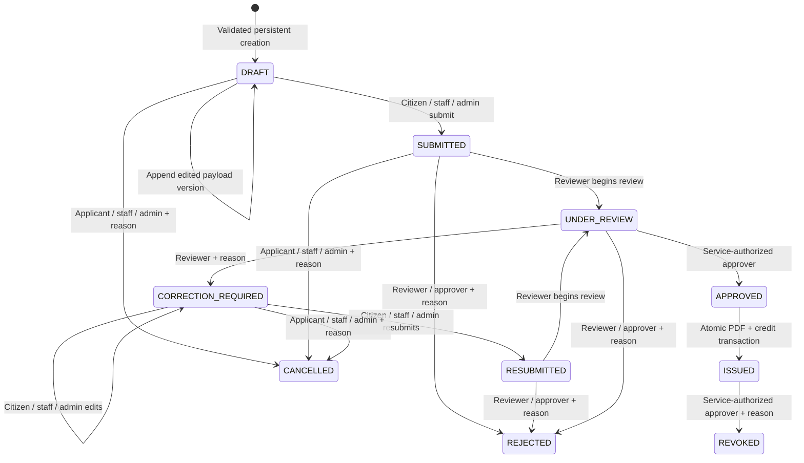

# Application and certificate state machine

This state machine is independently proposed and implemented for synthetic demonstration. Prottoyon's final submission, approval, issue and renewal paths were not verified. The executable policy lives in [app.ts](../apps/api/src/app.ts), with states/checks in [001_initial.sql](../db/migrations/001_initial.sql).

## Implemented application states

| Operation | Required existing state | Role/condition | Persisted result |
|---|---|---|---|
| Create | No application | Citizen own profile, or staff/admin within active tenant; operational service and valid complete schema | `DRAFT`, payload version 1, create event/audit |
| Edit | `DRAFT` or `CORRECTION_REQUIRED` | Citizen owner or staff/admin; valid persisted schema | New immutable version; same state; edit event |
| Submit | `DRAFT` | Citizen owner or staff/admin | `SUBMITTED` |
| Begin review | `SUBMITTED` or `RESUBMITTED` | Reviewer | `UNDER_REVIEW` |
| Request correction | `UNDER_REVIEW` | Reviewer; reason 3–500 characters | `CORRECTION_REQUIRED` |
| Resubmit | `CORRECTION_REQUIRED` | Citizen owner or staff/admin | `RESUBMITTED` |
| Approve | `UNDER_REVIEW` | Active approver membership plus service authorization; active user/tenant | `APPROVED`, approved actor/version |
| Reject | Submitted/resubmitted/under review | Reviewer or approver; reason 3–500 characters | `REJECTED` |
| Cancel | Draft/submitted/correction required | Citizen owner or staff/admin; reason 3–500 characters | `CANCELLED` |
| Issue | `APPROVED`, approved version=current | Active authorized approver, enabled service, active subscription and enough credit | Atomic `ISSUED` document/debit/history/outbox |
| Revoke | Issued certificate | Active service-authorized approver; reason 3–500 characters | Certificate/application `REVOKED`, retained PDF/history |

Rejection currently uses role/tenant policy; it does not additionally require a service authorization row. Approval, issuance and revocation do. Admin has drafting/administrative privileges and cannot replace the reviewer or approver. Reviewer assignment/claiming is not modeled yet; a reviewer can act on their tenant's submitted queue.

All transitions lock the application and append an event with actor, prior/new states, timestamp and any required reason. No GET mutates applications or financial records. Invalid state/role operations are rejected; denied tenant-scoped attempts create an audit event without exposing the other tenant's record. Application lists and detail enforce citizen ownership in addition to tenant scope.

## Version and approval rules

Creation requires a valid complete operational form. The release does not yet save partially valid drafts. Each edit appends JSON plus a stable SHA-256 payload hash and advances `latest_version`; previous versions cannot be updated/deleted. The schema JSON is immutable in PostgreSQL and server validation uses its exact stored version. Approval sets `approved_by` and `approved_version`.

An approved application cannot be edited. Issuance rechecks `approved_version = latest_version` after locking. A future official correction/revision must create an explicit new approved revision; bypassing the state machine by overwriting payload is not an implemented operation.

## Issuance and failure semantics

The API first checks authority and approved data, then renders a real DEMO PDF in memory. The final serializable transaction repeats those checks, locks the current application, subscription and wallet, and returns an existing certificate if another request committed. It persists PDF bytes, certificate, one credit debit, `ISSUED` state, event/audit and outbox together.

| Failure or repeat | Observable result |
|---|---|
| Insufficient credit | HTTP 402 `INSUFFICIENT_CREDITS`; application stays approved; no certificate/debit |
| Expired/inactive subscription | HTTP 402 `SUBSCRIPTION_INACTIVE`; approved application retained |
| Disabled service or removed approver authority | Rejected; no issued state or partial charge |
| Rendering failure | No final transaction commits; approved application retained |
| Database failure after attempted debit | Whole transaction rolls back, including document and credit |
| Concurrent requests/lost response retry | Same committed certificate; one charge; HTTP 200 or 201 depending race branch |
| Repeat issue after revocation | Existing revoked certificate metadata; no replacement issue or charge |

`ISSUANCE_PENDING` is a blueprint design state for a future background queue, not a persisted state in this synchronous release. Insufficient funds retain `APPROVED`. `EXPIRED` and multi-step approval are not implemented states. Renewal uses a new linked DRAFT and the same tested state machine.

## Certificate and verification lifecycle

An issued certificate has unique UUID/number, tenant/application, template version, issuer/timestamp, protected PDF bytes, opaque random verification token and its hash. New issues use template version 4 and the protected response includes `templateVersion`; previously stored version-1/2/3 documents retain their original bytes/metadata. A retry returns the existing certificate rather than upgrading its template or charging again. Current certificate states are `ISSUED` and `REVOKED`. The API's protected row serializer returns PDF and verification links; the public database function returns only status, office, service, issue date and demo flag. No citizen name, birth date, address, NID/BRN, payload, tenant billing balance or private attachment is returned publicly.

QR possession permits public status verification only. It does not grant PDF/profile access or prove real official validity. Invalid tokens return a generic not-found response. Revocation retains original bytes and issuance charge, stores reason/time, appends history and immediately reports `REVOKED` at the original QR link. The PDF explicitly says `DEMO / NOT OFFICIAL`; the database enforces demo tenants/plans and no official seal/signature is generated.

The version-4 renderer supports all 47 operational service forms. Resident #45 keeps its tested address, residency date and purpose layout with genuine `bn`, `en` or `bilingual` body/header content; the DEMO banner remains bilingual. Other services render labeled sections from the exact approved schema, including family-member/heir/correction repeatable rows and trade business/proprietor fields. Compact heading/field spacing keeps the sample family/trade documents and their QR footer on one page; longer records can paginate. Attachment content and handles stay private; documents indicate only that supporting documents are attached. Every service has been created, submitted, reviewed, approved and issued through real PostgreSQL in `ALL47-01`, with a PDF, minimal verification response and exactly one debit. These independently authored templates do not establish official service rules or legal validity. Perfect Unicode copy/accessibility mappings remain document-quality work.

## Implemented renewal

`POST /applications/:id/renew` creates a new DRAFT from an issued source owned by the same tenant and citizen. A supplied payload may replace the prior approved payload, but must satisfy the current schema. Trade renewal pins the previous-license flag and number to the actual source certificate. The immutable source remains available. One active renewal per source is enforced by a PostgreSQL partial unique index; canceled/rejected children allow a replacement. The child requires fresh review/approval and one new issuance credit. Concurrent requests cannot create multiple active successors or multiple debits. Revoking the source blocks even an already-approved renewal at final issue. Renewal does not automatically expire or revoke the source; no unverified legal supersession policy is implied.

## Proposed lifecycle extensions

Define official expiry, renewal eligibility periods and whether renewal supersedes or expires an old document; no reference evidence settles this policy. Add official signing/appointment records and configurable expiry only after authority and domain approval. The implemented demo lineage is a software workflow, not an official policy.

Background issuance should introduce `ISSUANCE_PENDING` with a durable job, idempotent artifact creation, safe retries and the same atomic financial invariants. Multi-step approval needs explicit stage assignments and decision records. Partial drafts require a separate partial-validation policy; final submission must enforce full validation. These are proposed requirements, not current behavior.

Evidence: APP-01/02/03/04, CER-01/02/03/04, WAL-01/02/03/04 and AUTH-02 in [integration tests](../apps/api/test/integration.test.ts). `ALL47-01`, `CER-RENEW`, `CER-REVOKE` and `PDF-ALL` in [expansion tests](../apps/api/test/expansion.test.ts) exercise all-service issuance and renewal lineage. [Full backend log](../execution/backend-full.log) and [47-service evidence](../execution/all-services-qa.json) record actual runs. PDF Unicode rendering/QR image QA and actual browser journeys are separately tracked in [TEST_MATRIX.md](TEST_MATRIX.md).
