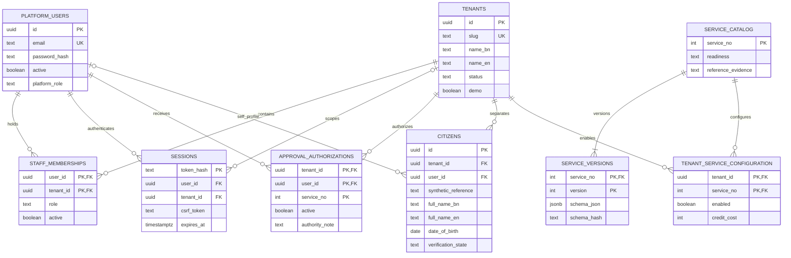
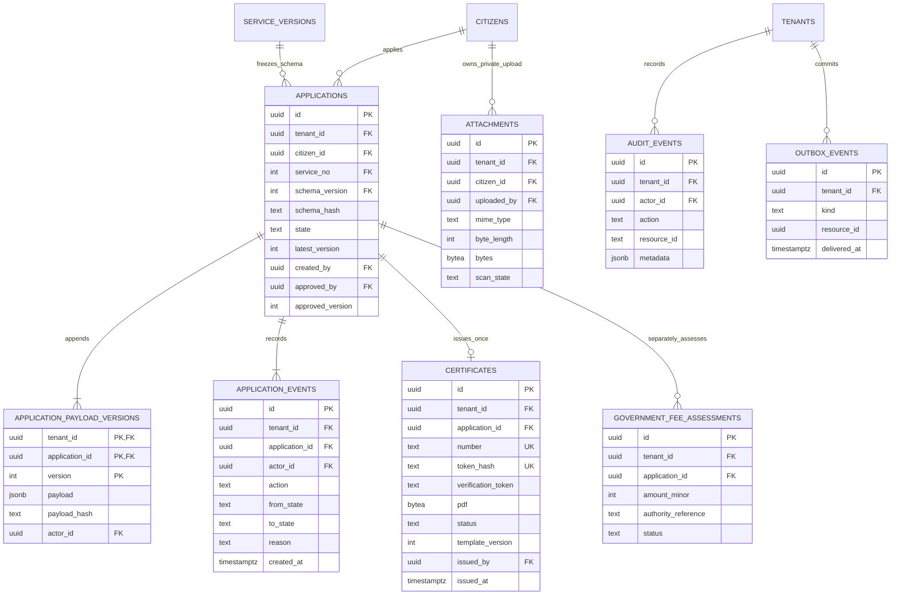
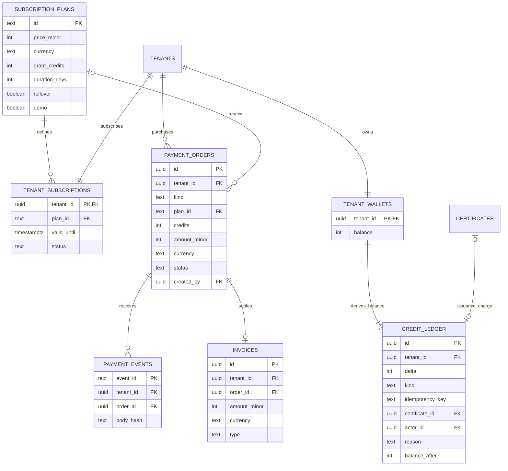

# PostgreSQL design — implemented schema and next extensions

The executable source is [001_initial.sql](../db/migrations/001_initial.sql), with wallet privilege hardening in [002](../db/migrations/002_ledger_balance_privileges.sql) and [003](../db/migrations/003_wallet_lock_function.sql). The first migration creates 24 product tables; [migrate.ts](../scripts/migrate.ts) separately manages `schema_migrations`. The local database is actual PostgreSQL 17.11. The diagrams below describe implemented relationships, not reference-site internals.

## Identity, organization and service configuration

`platform_role` currently allows the SaaS `owner` only; tenant roles are membership values. A role named approver is insufficient by itself: active `approval_authorizations` rows grant specific services. Those rows are synthetic demonstration authorizations, not evidence of appointment by a public authority. The authorization service number is checked against application/catalog usage in the API; that column does not yet have a catalog foreign key.

The catalog contains all 47 audited entries, each with an independently specified operational schema. Original service 2/42/45 version 1 schemas remain immutable; new versions and historical new-service snapshots are recorded alongside them. Read-only evidence previews use version 0. Creation selects the latest implemented operational version; application validation and PDF rendering use the exact pinned version. Catalog readiness does not certify official domain rules or the reference system's downstream workflows.

## Portal expansion

Migration [004](../db/migrations/004_portal_management.sql) adds office geography/type, tenant-scoped `notices` and `renewal_links`, FORCE RLS, directory/queue indexes and a narrow public-notices function. Only published notices from active offices are public. A renewal links one new application to a source certificate using composite tenant foreign keys. An insertion trigger requires the same citizen and service and an issued source; a partial unique index permits one active successor. Canceled/rejected renewals release the source for a replacement. Issued renewals retain the link permanently. The final issue transaction locks and rechecks the source certificate's status.

Migration [006](../db/migrations/006_portal_tools.sql) adds public feedback/subscription records, private print jobs, notification receipts and profile fields; its executable definitions are authoritative. These are independent product tables, not inferred reference-database internals.

## Applications, documents and audit

Every application payload is an immutable numbered JSON document with a SHA-256 hash. Edits append a version and increment `latest_version`; approval records `approved_version`. Issuance requires equality between those versions. The SHA-256 hashes provide stable change detection, not an official electronic signature or protection from a privileged database administrator.

Certificates are unique by `(tenant_id, application_id)`, with globally unique document number and token digest. New PDF issues record template version 2; prior version-1 PDF bytes/version are retained, and retries do not rewrite them. PDF bytes remain protected in PostgreSQL for this slice. Citizen birth dates are parsed as calendar strings (`YYYY-MM-DD`), preserving the day independently of host timezone. Attachment handles in payloads reference existing private uploads for the same tenant **and applicant**. No normalized `application_attachments` join table exists yet. Attachments are limited to 2 MiB and remain `UNSCANNED`.

## SaaS accounting

The diagrams abbreviate secondary fields and omit repetitive tenant/user links. The SQL migration is authoritative. State strings, role strings, positive credit costs, nonnegative amounts/balances, upload sizes and `demo=true` have database checks.

## Isolation and integrity rules

- Tenant tables enable **and force** row-level security. Every request transaction sets `astra.tenant_id` locally from the authenticated membership; unscoped reads return no tenant rows. The application role is `NOSUPERUSER NOBYPASSRLS`.
- Composite foreign keys include the tenant for application→citizen, payload/event→application, certificate→application, ledger→certificate, payment event/invoice→order, official assessment→application and attachment→citizen. Changing an identifier cannot join records from different tenants.
- Unique constraints prevent duplicate tenant synthetic citizen references, application payload versions, issued certificates, ledger idempotency keys and order invoices. A partial unique index permits one issuance charge per tenant/certificate.
- Triggers reject UPDATE/DELETE on ledger, payload versions, application events, audit events, payment events, invoices and service versions. A ledger INSERT trigger locks the wallet, handles duplicate idempotency keys without changing balance, rejects negative balances and updates the balance cache. Migration 002 revokes all application UPDATE privileges on wallets and makes the trigger an owner-trusted SECURITY DEFINER function with a pinned search path. Migration 003 grants access to a narrow, context-derived wallet-locking read; it does not grant balance writes.
- Global auth/configuration tables are deliberately not tenant-RLS tables. API policy controls access. RLS trusts the service to set the correct context; possession of the database credential is outside the ordinary tenant-user boundary.

Evidence: [integration tests](../apps/api/test/integration.test.ts), TEN-01/02, APP-04, WAL-01/02/04/06 and SEC-02; [captured successful run](../execution/clean-bootstrap.log).

## Proposed extensions — not migrated

| Product area | Proposed records | Required before activation |
|---|---|---|
| Lawful identity and addresses | `citizen_addresses`, `identity_verification_events`, provider consent/attempt records | Approved identity source and OTP provider; no invented government contract |
| Office administration | `tenant_offices`, normalized role/permission grants, appointments and service scopes | Authenticated onboarding and real authority verification |
| Domain configuration | Approved fee schedules, template versions, tenant schema overrides | Version governance and domain sign-off for each service |
| Advanced workflow | Review assignments, multi-step approval, correction/revision records | Assignment-aware permissions and immutable history |
| Renewal | `renewal_links`, certificate revisions, prior-license checks | CER-05 scenarios and office-approved rules |
| Production finance | Credit lots/expiry, plan cycles, reconciliation/refunds, statutory payment records | Approved commercial pricing and separate lawful statutory collection |
| Operations | Worker delivery attempts, retention/legal holds, export jobs and restore manifests | Recovery drill, observability and operational policy |

These additions preserve `tenant_id`, composite references and tested policy boundaries. They do not represent tables discovered in Prottoyon or modules already built.
