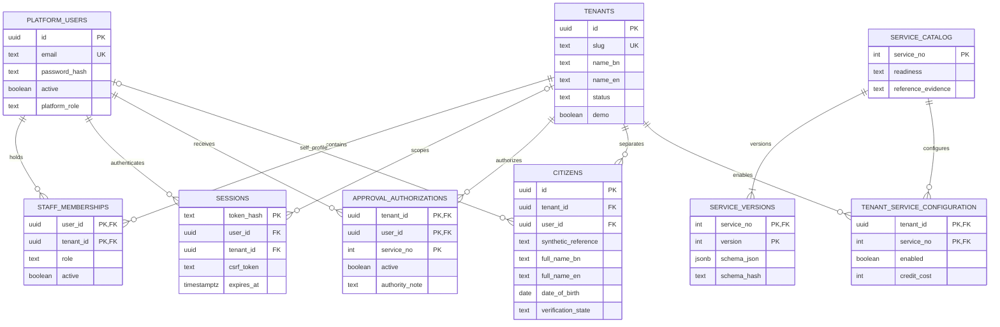
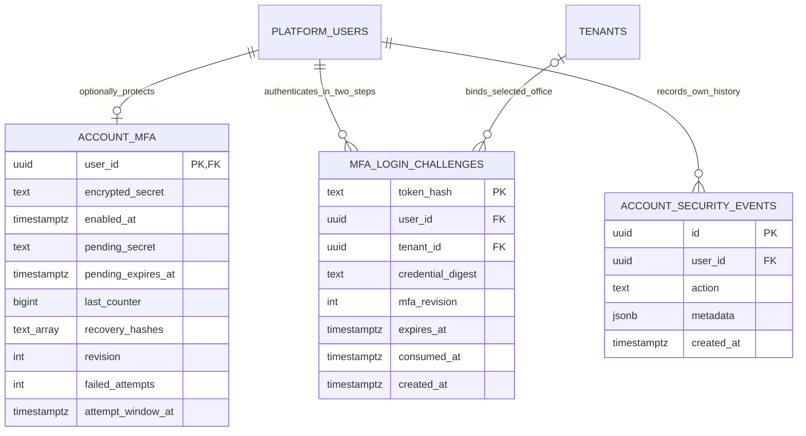
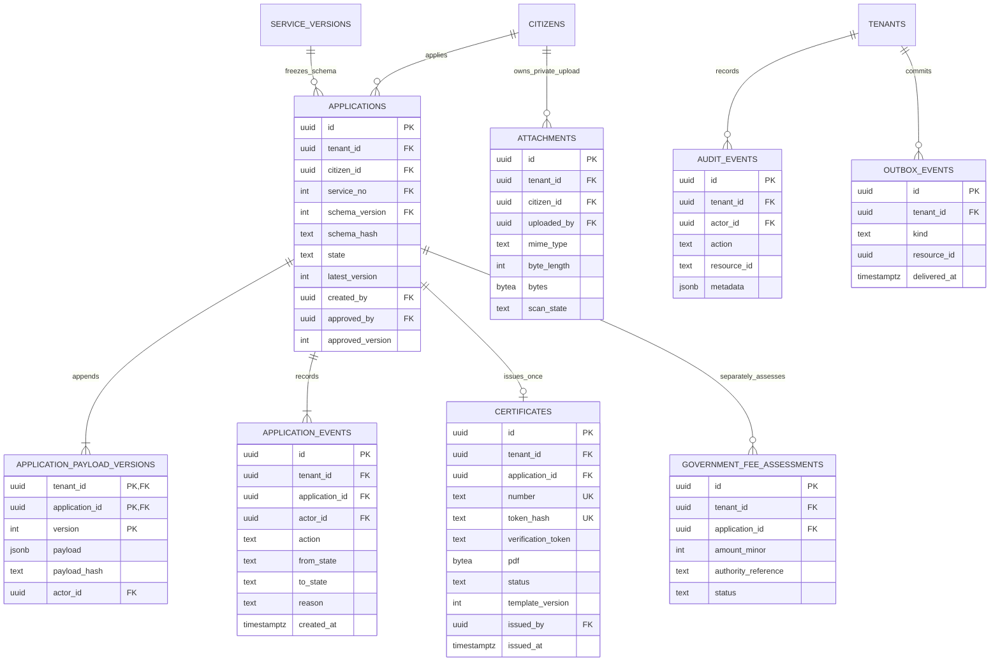
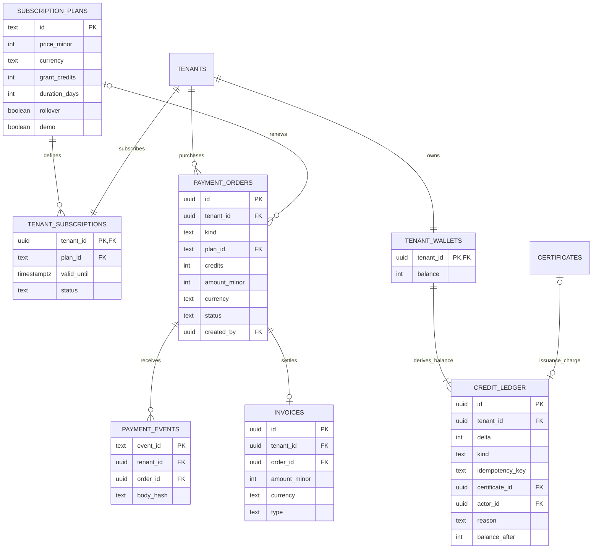

# PostgreSQL design — implemented schema and next extensions

The executable source is the [SQL migration directory](../db/migrations/), starting with [001_initial.sql](../db/migrations/001_initial.sql) and wallet privilege hardening in [002](../db/migrations/002_ledger_balance_privileges.sql) and [003](../db/migrations/003_wallet_lock_function.sql). [migrate.ts](../scripts/migrate.ts) separately manages `schema_migrations`. The local database is actual PostgreSQL 17.11. These diagrams describe implemented relationships, not reference-site internals.

**0.8 candidate:** migrations [013](../db/migrations/013_account_mfa.sql) and [014](../db/migrations/014_audit_tenant_integrity.sql) add account authentication/history and audit completeness rules. Their presence in source is not proof of hosted migration or deployment. The established 0.7 live baseline and new release acceptance are recorded separately in [HOSTED_DEPLOYMENT.md](HOSTED_DEPLOYMENT.md) and [RELEASE_0_8.md](RELEASE_0_8.md).

## Identity, organization and service configuration

`platform_role` currently allows the SaaS `owner` only; tenant roles are membership values. A role named approver is insufficient by itself: active `approval_authorizations` rows grant specific services. Those rows are synthetic demonstration authorizations, not evidence of appointment by a public authority. The authorization service number is checked against application/catalog usage in the API; that column does not yet have a catalog foreign key.

The catalog contains all 47 audited entries, each with an independently specified operational schema. Original service 2/42/45 version 1 schemas remain immutable; new versions and historical new-service snapshots are recorded alongside them. Read-only evidence previews use version 0. Creation selects the latest implemented operational version; application validation and PDF rendering use the exact pinned version. Catalog readiness does not certify official domain rules or the reference system's downstream workflows.

## Account authentication and security history — 0.8 candidate

MFA belongs to the global account, across all office memberships. `account_mfa` has at most one row per user; absence of an active secret leaves existing accounts unenrolled. Database checks require the active secret/enabled timestamp and pending secret/expiry to be present or absent together. Pending and active seeds are AES-256-GCM ciphertext with account-bound authenticated data; the independent deployment encryption key is not stored in these tables. Only hashes of ten random, one-use recovery codes are retained.

`account_mfa` and `account_security_events` enable and force account RLS using transaction-local `astra.account_id`. They have non-null user foreign keys. The runtime may SELECT/INSERT/UPDATE MFA state, but only SELECT/INSERT account-security history; an immutable trigger also rejects history UPDATE/DELETE. Event actions are constrained, metadata is an object and API writers include only relevant counts. The own-history endpoint returns the latest 50 records. This is not a cross-account administrative access-review feature.

`mfa_login_challenges` is a global authentication capability table, analogous to session infrastructure rather than tenant business data. The API resolves a hashed opaque token, then locks its account and rechecks its five-minute expiry, consumption, credential digest, MFA revision and selected office authorization. A nullable tenant is valid for a tenantless platform owner. It is not a session, and successful password verification does not insert a session for an enrolled account until its factor succeeds. There is no public challenge-list route.

The account lock serializes the TOTP counter, recovery-code consumption, database-backed attempt budget and session creation. Activation, disabling, code rotation, password changes and other-session revocation invalidate relevant pending capabilities. Password recovery cannot bypass enrolled MFA. Retention cleanup for expired/consumed challenges and security events, privileged recovery and mandatory enrollment remain pending. Details and tested boundaries: [ACCOUNT_SECURITY.md](ACCOUNT_SECURITY.md), [MFA API tests](../apps/api/test/mfa.test.ts).

## Portal expansion

Migration [004](../db/migrations/004_portal_management.sql) adds office geography/type, tenant-scoped `notices` and `renewal_links`, FORCE RLS, directory/queue indexes and a narrow public-notices function. Only published notices from active offices are public. A renewal links one new application to a source certificate using composite tenant foreign keys. An insertion trigger requires the same citizen and service and an issued source; a partial unique index permits one active successor. Canceled/rejected renewals release the source for a replacement. Issued renewals retain the link permanently. The final issue transaction locks and rechecks the source certificate's status.

Migration [006](../db/migrations/006_portal_tools.sql) adds public feedback/subscription records, private print jobs, notification receipts and profile fields; its executable definitions are authoritative. These are independent product tables, not inferred reference-database internals.

Later deployed-baseline migrations add tenant password-recovery tokens ([007](../db/migrations/007_account_recovery.sql)), bounded public tracking ([008](../db/migrations/008_tracking.sql)), managed-owner public-read policies ([009](../db/migrations/009_managed_public_read.sql)), Bangladesh geography ([010](../db/migrations/010_bangladesh_geography.sql)), versioned fees/order snapshots ([011](../db/migrations/011_application_orders.sql)), and gateway attempts/receipts/reconciliation ([012](../db/migrations/012_gateway_payments.sql)). See [order workflow](ORDER_WORKFLOW.md), [gateway payments](GATEWAY_PAYMENTS.md) and [geography integration](GEOGRAPHY_INTEGRATION.md) for their contracts. Hosted collection remains disabled.

## Applications, documents and audit

Every application payload is an immutable numbered JSON document with a SHA-256 hash. Edits append a version and increment `latest_version`; approval records `approved_version`. Issuance requires equality between those versions. The SHA-256 hashes provide stable change detection, not an official electronic signature or protection from a privileged database administrator.

Certificates are unique by `(tenant_id, application_id)`, with globally unique document number and token digest. New PDF issues record template version 2; prior version-1 PDF bytes/version are retained, and retries do not rewrite them. PDF bytes remain protected in PostgreSQL for this slice. Citizen birth dates are parsed as calendar strings (`YYYY-MM-DD`), preserving the day independently of host timezone. Attachment handles in payloads reference existing private uploads for the same tenant **and applicant**. No normalized `application_attachments` join table exists yet. Attachments are limited to 2 MiB and remain `UNSCANNED`.

Migration 014 makes `audit_events.tenant_id` **NOT NULL**. PostgreSQL validates every existing row, including rows hidden by forced RLS; a legacy NULL aborts the migration rather than being omitted from an all-tenant export. The migration does not rewrite, delete or reassign history and does not weaken RLS. Tenantless owner/account security actions use `account_security_events`, not tenant audit rows. The [audit-integrity regression](../apps/api/test/audit-integrity.test.ts) exercises hidden-NULL rejection and successful validation on isolated temporary tables.

## SaaS accounting

The diagrams abbreviate secondary fields and omit repetitive tenant/user links. The SQL migration is authoritative. State strings, role strings, positive credit costs, nonnegative amounts/balances, upload sizes and `demo=true` have database checks.

## Isolation and integrity rules

- Tenant tables enable **and force** row-level security. Every request transaction sets `astra.tenant_id` locally from the authenticated membership; unscoped reads return no tenant rows. The application role is `NOSUPERUSER NOBYPASSRLS`.
- Composite foreign keys include the tenant for application→citizen, payload/event→application, certificate→application, ledger→certificate, payment event/invoice→order, official assessment→application and attachment→citizen. Changing an identifier cannot join records from different tenants.
- Unique constraints prevent duplicate tenant synthetic citizen references, application payload versions, issued certificates, ledger idempotency keys and order invoices. A partial unique index permits one issuance charge per tenant/certificate.
- Triggers reject UPDATE/DELETE on ledger, payload versions, application events, audit events, payment events, invoices and service versions. A ledger INSERT trigger locks the wallet, handles duplicate idempotency keys without changing balance, rejects negative balances and updates the balance cache. Migration 002 revokes all application UPDATE privileges on wallets and makes the trigger an owner-trusted SECURITY DEFINER function with a pinned search path. Migration 003 grants access to a narrow, context-derived wallet-locking read; it does not grant balance writes.
- Global auth/configuration tables are deliberately not tenant-RLS tables. The new MFA state and account-security history have their own forced account RLS; login challenges and sessions remain global authentication infrastructure with explicit API ownership/capability checks. RLS trusts the service to set the correct context; possession of the database credential is outside the ordinary user boundary.
- Managed recovery exports known tenant/account scopes only after validating exact policies, non-null scope columns and validated foreign-key paths. Restores use a separate fresh cluster, original application object-owner names and new restricted credentials; neither source role passwords nor provider memberships are recreated. Backup completeness, key custody and operational cutover acceptance are described separately in [BACKUP_AND_RECOVERY.md](BACKUP_AND_RECOVERY.md).

Evidence: [integration tests](../apps/api/test/integration.test.ts), TEN-01/02, APP-04, WAL-01/02/04/06 and SEC-02; [captured successful run](../execution/clean-bootstrap.log).

## Proposed extensions — not migrated

| Product area | Proposed records | Required before activation |
|---|---|---|
| Lawful identity and addresses | `citizen_addresses`, `identity_verification_events`, provider consent/attempt records | Approved identity source and OTP provider; no invented government contract |
| Office administration | `tenant_offices`, normalized role/permission grants, appointments and service scopes | Authenticated onboarding and real authority verification |
| Domain configuration | Officially approved tariff/template rules and tenant schema overrides beyond current versioned fee configuration | Version governance and domain sign-off for each service |
| Advanced workflow | Review assignments, multi-step approval, correction/revision records | Assignment-aware permissions and immutable history |
| Renewal extensions | Certificate revisions and official prior-license checks beyond implemented `renewal_links` | Office-approved eligibility, expiry and supersession rules |
| Production finance | Credit lots/expiry, plan cycles, reconciliation/refunds, statutory payment records | Approved commercial pricing and separate lawful statutory collection |
| Operations | Worker delivery attempts, retention/legal holds, export jobs and restore manifests | Recovery drill, observability and operational policy |
| Account governance | Privileged assisted recovery, mandatory MFA policy, access-review decisions and security-event retention | Approved identity/dual-control policy and audited positive/negative recovery tests; no bypass of enrolled factors |

These additions preserve `tenant_id`, composite references and tested policy boundaries. They do not represent tables discovered in Prottoyon or modules already built.
