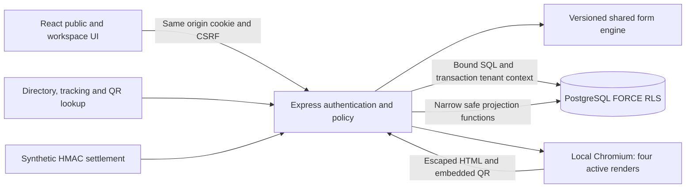

# Astra 0.2 system architecture

Astra is an independently authored TypeScript modular monolith: React frontend, Express API and real PostgreSQL. Public, citizen, office and platform-owner views share one deployment. All 47 services have persisted, versioned demonstration workflows. The completed reference audit is evidence, not a specification of unobserved server behavior or official legal rules.

## Components and deployment

| Component | Actual responsibility | Source |
|---|---|---|
| React frontend | Responsive public catalog/directory/notices/help/support; signup/recovery; citizen/office workflows; administration, printing, billing and owner tools | [web](../apps/web/src/) |
| Main API | Authentication, citizen scope, workflow, approval, issuance/revocation, uploads and credits | [app.ts](../apps/api/src/app.ts) |
| Management API | Office directory/notices, signup/password/recovery, memberships/grants/service settings and owner tenant controls | [management.ts](../apps/api/src/management.ts) |
| Portal tools | Feedback/subscription interest, profiles, private biodata/holding/witness PDFs, reports, notifications, safe tracking and invoice PDFs | [portal-tools.ts](../apps/api/src/portal-tools.ts) |
| Shared forms | 47 latest schemas; 93 immutable operational versions; observed 48 initial forms; bilingual conditional/repeatable validation | [schemas](../packages/shared-schemas/src/), [manifest](../packages/shared-schemas/schema-release.json) |
| PostgreSQL | RLS/composite references, immutable payload/history/ledger, PDF bytes, notices/recovery/print records | [migrations](../db/migrations/), [ERD](ERD.md) |
| PDF renderer | Local QR, escaped approved service data, template4, protected PDF bytes | [pdf.ts](../apps/api/src/pdf.ts), [template](../apps/api/src/certificate-template.ts) |
| HTTP/runtime | CSP/security headers, Origin/rate checks, configuration validation, compressed built assets and graceful shutdown | [hardening](../apps/api/src/http-hardening.ts), [server](../apps/api/src/server.ts) |

The executed local path uses web127.0.0.1:5173, API127.0.0.1:3001 and PostgreSQL17.11 on127.0.0.1:55432. Vite proxies API calls in development. The built app serves frontend/API on one origin; hashed assets use compression/immutable caching and HTML/private responses use no-store. Production startup requires an exact HTTPS origin, restricted database URL and unique HMAC secret. Docker/Compose and reverse-proxy examples are supplied; container/hosted execution is unverified. See [DEPLOYMENT.md](DEPLOYMENT.md).

## Identity and authorization

Passwords use salted scrypt. Eight-hour server sessions store the random token's hash; cookies are HttpOnly/SameSite=Strict and Secure in production. Mutations require the CSRF token and reject a conflicting Origin, including public authentication writes. Active user/membership/tenant are checked on every authenticated request. Login chooses the first active membership; a multi-office switcher and MFA remain future work.

Signup creates only a synthetic citizen. Password change verifies the current password and expires other sessions. Admin-assisted recovery creates a one-use15-minute token stored only as a hash. It excludes owners, admins, foreign/inactive accounts and accounts with another office membership. Redemption rechecks eligibility, consumes under transaction locks and expires all sessions. Administrators must convey the link through a trusted channel; no email/SMS delivery is claimed.

Tenant admins manage office profiles, accounts/memberships, service enablement/costs, notices and explicit DEMO service grants. They cannot directly approve/issue. Approvers require active service-specific authority, checked again under locks at issuance. Owners provision/suspend tenants and manage commercial records without citizen access or issuing authority. New offices start with zero credits and an expired subscription.

Tenant transactions use `set_config(...,true)` so pool connections do not retain scope. FORCE RLS and composite tenant foreign keys supplement API role/ownership checks. RLS trusts the service-set context: a compromised DB service credential can set another context. No tenant-facing SQL interface is offered. Migration/backup administrators are separately privileged.

## Versions and evidence boundaries

Latest schemas are v2 for46 services and v1 for resident45. Original schemas and initially published new-service v1 snapshots remain exact, totaling93 operational versions; read-only reference previews use v0. Seed checks published schema hashes and rejects drift. Creation uses the latest version; edits/review/approval/PDFs use the application's immutable stored version and payload hash. Complete validation is required to save a draft; partial drafts are not implemented.

Forms support localized values, conditions, repeatable family/heir/correction rows, private attachment handles and service-specific facts. Latest family/trade versions retain the captured entry fields. Compiled and persisted schema releases must stay synchronized using the checked manifest. None of this establishes legal eligibility, official document text, statutory fees or the reference site's unobserved success paths. See [SERVICE_IMPLEMENTATION.md](SERVICE_IMPLEMENTATION.md) and [EVIDENCE_TRACEABILITY.md](EVIDENCE_TRACEABILITY.md).

## Workflow and atomic documents

The state machine is draft → submit → reviewer review → optional correction/resubmission → authorized approval → issue. Edits append payload versions; approval pins the current one. GET does not create applications, advance state or debit credits. Queues have scoped filters and bounded pagination.

Issuance prepares the DEMO PDF before the final serializable transaction. That transaction locks/rechecks application, authority, subscription, enabled service/cost and wallet, then atomically stores certificate/PDF, one debit, state/history/audit and outbox event. Unique certificate/application and debit/certificate constraints prevent duplicate charges. Retry returns the existing document. Rendering/authorization/funds/subscription/transaction failures leave no partial issue or debit.

Renewal creates a linked application for the same tenant/citizen/service. A DB trigger validates lineage; a partial unique index permits one active successor. Cancel/reject allows replacement. Trade previous-license numbers are server-pinned to the source certificate. Renewal needs new review/approval and one new issuance credit. Source revocation blocks final issue. No automatic legal expiry/supersession policy is invented.

Template4 renders approved service-specific sections and repeatables. Simple family/trade examples fit one A4 page after visual QA; longer applications can paginate. Resident supports actual Bangla, English or bilingual bodies. Stored templates1–3 remain immutable. Every document says DEMO/NOT OFFICIAL and contains no government seal/signature. Nirmala UI/Noto Sans Bengali supplies shaping; perfect ligature extraction or screen-reader mapping is not claimed.

Chromium permits four active renders and32 queued requests, returning503 when saturated. Remote requests are blocked, content loading is limited to15 seconds, and launch/disconnection failure clears the browser for retry. These are process-level controls, not a production capacity benchmark. QR lookup uses a256-bit token and exposes only status/office/service/time/demo. Application tracking is likewise minimal; PDFs and payloads remain protected.

## Supporting modules and remaining work

| Domain | Implemented | Remaining external or unverified work |
|---|---|---|
| Public portal | Directory/notices search, 47-service catalog, safe tracking/verification, persisted support/subscription interest | Actual email/SMS dispatch and reference downstream equivalence |
| Office | Roles/grants/settings, review/corrections, all-service issuance/renewal/revocation | Official appointment/domain approval and assigned multi-stage review |
| Printing | Idempotent private biodata/holding/witness PDFs and history | Official holding/tax registry or municipal receipt integration |
| SaaS finance | Sandbox subscriptions/top-ups, invoices/PDFs, immutable prepaid ledger, adjustments and reports | Live prices/providers, refunds/reconciliation, credit-expiry policy |
| Statutory fees | Separate unconfigured assessment table | Approved schedules, collection and receipt authority |
| Communications | Durable outbox, scoped in-app notifications/read receipts, owner support resolution | Background delivery worker and provider delivery proof |
| Operations | Real PostgreSQL tests, clean bootstrap, encrypted local recovery, deployment source | Docker/hosted rollout, load/availability, external security/accessibility audit |

Uploads are private DB bytes limited to2 MiB with MIME signature/end-marker checks and remain UNSCANNED. Full parsing/malware sanitization is absent. DB storage keeps certificate/ledger commits atomic; object storage would require private access/quarantine and equivalent consistency guarantees.

[OpenAPI](../apps/api/openapi.json) documents new contracts; runtime validation is authoritative. Reference AJAX remains evidence only. Real DB/API/browser tests cover isolation, history, all47 PDF workflows, exactly-once credits, rollback, management/recovery, public privacy, printing/reports and built assets. Final executed counts live in [TEST_MATRIX.md](TEST_MATRIX.md) and [EXECUTION_RESULTS.md](EXECUTION_RESULTS.md).

Lawful identity/data processing, official templates/authority, live providers, retention/export/closure, managed secrets and offsite recovery require separate decisions before real office use. The commissioning user owns the independent software; third-party dependencies/fonts retain their rights.
