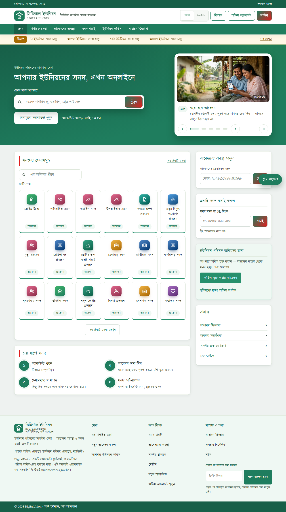
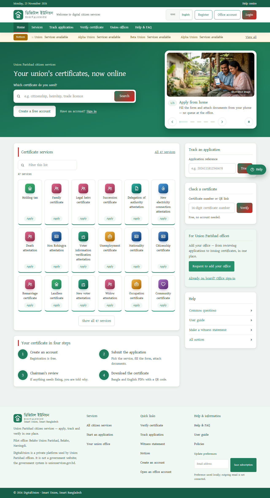
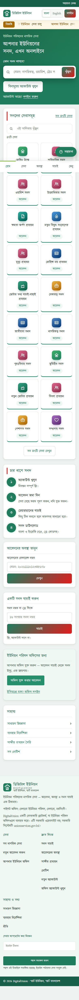
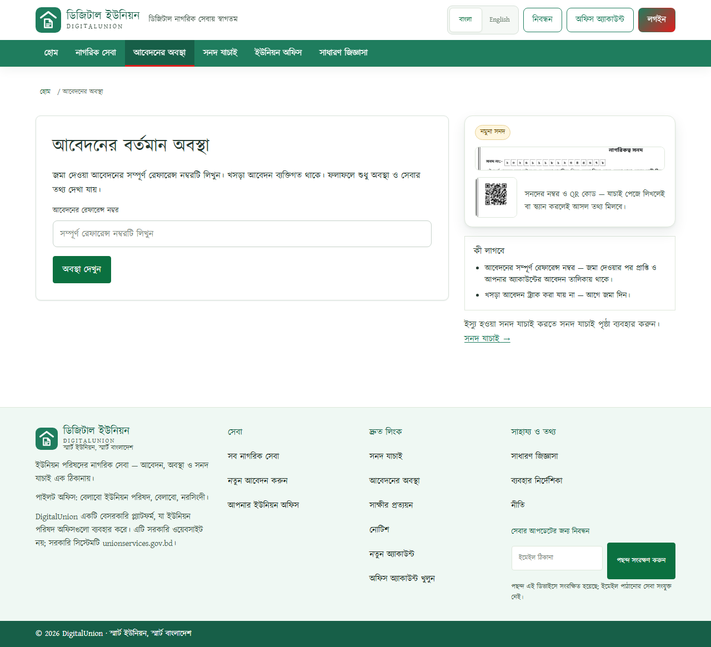

# Phase A — public portal (PORTAL-A)

**Date:** 23 Nov 2026 · **Branch:** `feat/redesign-a-public-site` on `d862197` · PR into `codex/initial-deployment`.
**Scope:** presentation only — the public header, menu, homepage and two shared stylesheets. **No API, schema, migration or package change.** Production untouched.

Owner direction for this phase: a simple, easy-to-use public site with the page structure of a familiar public service portal (prottoyon.live was the reference), **keeping DigitalUnion's own name, logo, artwork, wording and the PP-1 theme**. No logo, seal, image or text was taken from the reference site.

## What changed

| Area | Change |
|---|---|
| Header | Three account buttons on every public page: **নিবন্ধন / Register**, **অফিস অ্যাকাউন্ট / Office account** (new; hidden below 1024px, where the phone drawer carries it) and **লগইন / Login**. The citizen portal pages now use the same default buttons instead of their own pair. |
| Menu | One flat menu on a solid green bar with white links, no dropdowns: Home · Services · Track application · Verify certificate · Union offices · Help & FAQ. The current page sits on the darker green with the red brand underline. Notices and the witness generator moved to the home help card, the phone drawer and the footer. |
| Homepage | Was ten stacked sections. Now: notice ticker → compact hero (one search, register / sign in, a smaller carousel; the carousel is hidden below 900px) → two columns: **services** (the 47-service icon grid with one filter box, then the four steps) and a **side column** of quick jobs (track an application, check a certificate, for offices, help links). |
| Removed from the homepage | The three task tiles, the trust pillars and "already live" list, the office sales section with its sample queue, the inline FAQ list. The FAQ is on `/help`, office onboarding on `/register-office`; the "not a government website" statement stays in the footer on every page. |
| Home track card (new) | A reference typed on the homepage opens `/tracking?searchText=…`, which already runs the lookup on load. An empty entry is rejected in place. |
| Alignment | Hero, homepage body, notice ticker, global notice banner, public offers and every citizen-portal page now share the header's content edge (`.du-container`). Portal pages start 24px under the menu instead of 55px. |

Files: `PublicShell.tsx`, `PublicHome.tsx`, `HomeServiceDirectory.tsx` (`showCategories` prop; the homepage hides the 11 category tabs — category browsing stays on `/services`), `PublicPortal.tsx` (account override removed), `du-shell.css`, `public-home.css`, `public-portal.css`, `global-notices.css`.

## Tests (local, actual log counts)

| Check | Result |
|---|---|
| `tsc --noEmit` | clean |
| `npm run build` (incl. SEO prerender, 52 pages) | passes |
| Web suite, full run | **104 / 109**: the 4 production-bundle performance tests need `npm run build` first (they passed after it, see next row); 1 workspace test failed mid-run because the dev server hot-reloaded while I edited files during the run |
| Re-run after the build, no edits in flight | `performance-browser` **4 / 4**, family/trade workspace test **pass**, homepage test **pass**. The staff-registration test returns `409 DUPLICATE` on a re-run against the same database — the known test-isolation issue recorded in the Phase 1 report; it passed in the full run |

Updated tests: `public-home-browser.test.ts` (new section ids, the three header buttons, the exact six-item menu, the home track card end to end) and `public-usability-browser.test.ts` (Bangla home shows the track and verify cards).

## Screenshots (local stack, clean seed data)

| | |
|---|---|
| Home, Bangla, desktop |  |
| Home, English, desktop |  |
| Home, Bangla, 390px |  |
| Tracking page with the shared header |  |

## NOT VERIFIED / left for later phases

- Portal forms (`/tracking`, `/register`, `/login`, service pages) still use the legacy flat dark-green button; the homepage and header use the PP-1 gradient. Unifying them belongs to Phase B (citizen journey), which reworks those forms.
- The witness generator has no options until the owner enters them, so it is not in the main menu yet.
- No human usability walkthrough; layout checked by screenshots at 1280px and 390px only.
