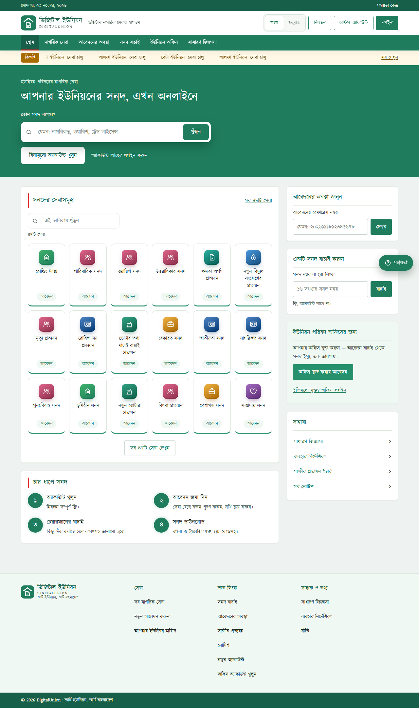
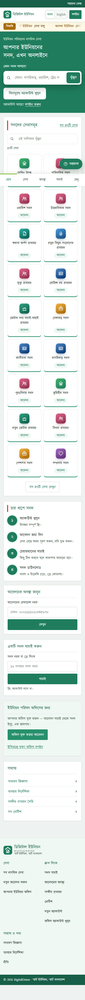
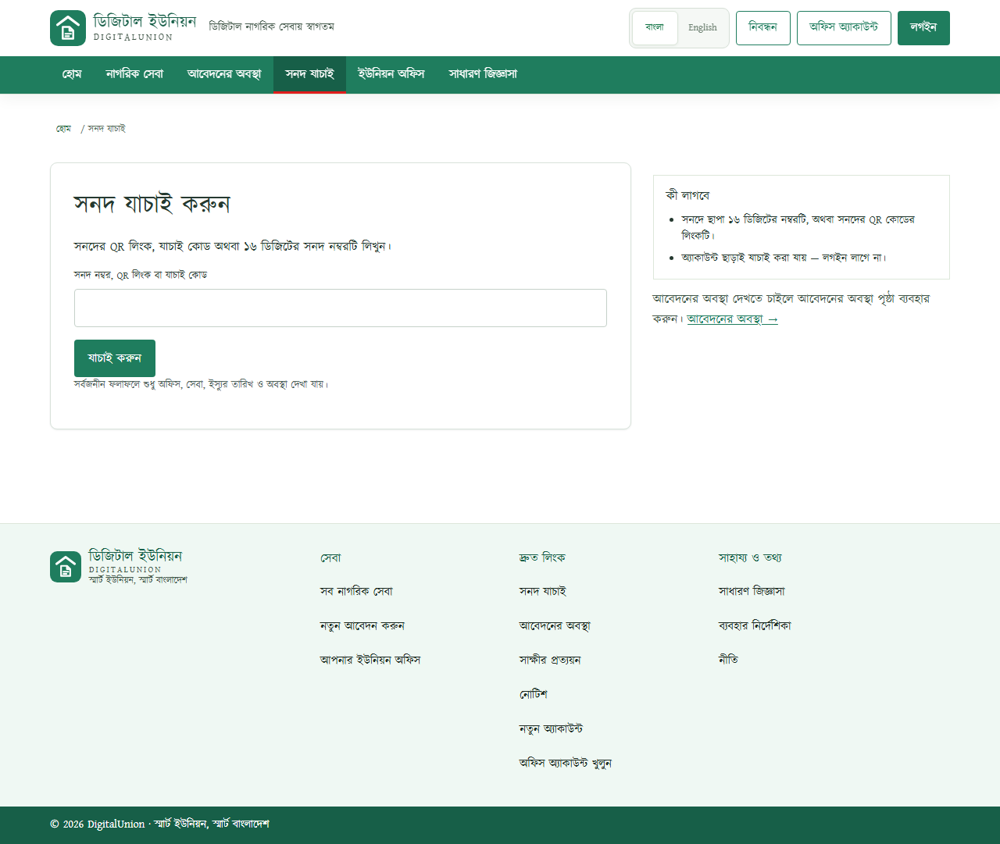

# Phase E — official portal (PORTAL-E)

**Date:** 23 Nov 2026 · **Branch:** `feat/portal-e-official` on `codex/initial-deployment` (`66df20f`, Phases A–D merged).
**Scope (owner, 23 Nov 2026):** (1) a formal government-portal look; (2) remove the pilot-office wording, the word "DEMO" from every citizen-facing surface, and any "about us / who we are" text; (3) add **no** new text; (4) do **not** touch the Belabo office record, already-issued certificates or production data.

**Changed:** web presentation, two web lookups (offices beyond the 100th), the cPanel environment template and the cPanel runbook only. **No API, schema, migration, package or data change** (`git diff origin/codex/initial-deployment -- apps/api db packages` is empty).

## What changed

| Area | Change |
|---|---|
| Look | Primary buttons are one solid chrome green (`#1f7d5e`, darker on hover) instead of the green→red gradient; corners 4px (controls) / 6px (panels) instead of 8 / 12; shadows reduced to a hairline. The homepage banner is plain solid green, one column. |
| Removed: illustrative imagery | The homepage photo carousel and its "প্রতীকী ছবি / Illustrative image" label. |
| Removed: "নমুনা সনদ / Sample certificate" pictures | On the tracking page, the verify page (form and result) and the "Done" screen after applying, with the sentences that pointed to them ("…the one above is a sample", "(shown in the sample above)"). |
| Removed: pilot office | "পাইলট অফিস: বেলাবো ইউনিয়ন পরিষদ…" in the footer and on the sign-in page. The Belabo **office record** is untouched. |
| Removed: about us | The footer's "DigitalUnion is a private platform… not a government website…" paragraph and its tagline sentence; the FAQ entry "What is DigitalUnion?". |
| Removed: a feature that did not work | The footer "updates" sign-up: outgoing email is not connected, so it promised updates nobody would send (its own note said so). The `/public/subscribe` API is unchanged; the form can return when email is live. |
| Fixed: offices beyond the 100th | The office list API returns at most 100 per page. Citizen signup looked for `?office=<slug>` (and the server's default office) only in the first 100, so it silently stopped preselecting once a deployment had more; it now looks the office up by its slug. Office-account registration listed only the first 100 offices in its dropdown; it now reads every page. Found because the local database reached 115 offices. |
| Official issuance in production | `.env.cpanel.example` now sets `ISSUANCE_MODE=official`. In official mode new certificates get plain 16-digit numbers (no `DEMO-` prefix) and the emblem artwork, and health reports `OFFICIAL`. Certificate PDFs carry no demo text in **any** mode (already so since 17 Nov; re-verified below). |

No text was added: every edit removes words or changes styling. (Code comments explain the changes; they are not shown to anyone.)

Kept deliberately: the government's name and emblem are **not** used anywhere in the site's chrome (the emblem appears only on official-mode certificates, as approved in CERTNO-01).

## Two production steps only the owner can take

Nothing in the code can make the live site official on its own, and rule 4 forbids me touching production data. To finish going live:

1. **Set the environment variable** on the live server (cPanel → the Node.js app → Environment variables): `ISSUANCE_MODE=official`, then restart the app (see `docs/DEPLOY-CPANEL.md`, section 9 "Going official", updated in this PR). Until this is set, new certificates keep the `DEMO-` number prefix.
2. **Mark each office that is really live as non-demo.** The public verification result reads the *office's* demo flag (`tenants.demo`, migration 041), not the code. While an office is still marked demo, every certificate it issues verifies as "এটি নমুনা (ডেমো) সনদ". There is no owner screen for this flag; it is one SQL statement per office, run by the owner on the production database **after taking a backup**, e.g.:
   ```sql
   UPDATE tenants SET demo = false WHERE slug = 'belabo-up';
   ```
   I have not run this and did not change it in code: it is the owner's production data (rule 4).

What stays truthful afterwards: certificates **already issued** with a `DEMO-` number keep verifying as demo — they were issued in demo mode, and rule 4 keeps them as they are. Only new certificates are official.

## Verification (local, actual log counts)

| Check | Result |
|---|---|
| `tsc --noEmit` | clean |
| API: `issuance-mode`, `certno`, `certificate-assets` | **30 / 30** — incl. "template 6 certificate carries no DEMO branding or disclaimer lines in any mode", the official-mode equivalent, the emblem watermark and the signature gate |
| Web suite, first full run | 109 / 112 — found the over-100-offices signup bug (fixed above) and my fragile Phase D "Settings on screen" check (fixed); the 3rd was the known `409 DUPLICATE` |
| Web suite, final full run (after the fixes and a rebuild) | **111 / 112** — the one failure is the staff-registration test's `409 DUPLICATE` on a non-fresh database (known since the Phase 1 report) |
| Screens checked at 1280px | home, verify, tracking: no page errors, no horizontal overflow |

Updated tests: `public-home-browser` (no footer sign-up), `expanded-browser` (no footer sign-up; the API keeps its own test), `consoles-browser` (its "Settings on screen" check depended on how many announcement banners the database had; it now checks that Settings lies inside the menu's visible area).

## Screenshots (local stack, clean seed data)

| | |
|---|---|
| Home, Bangla, desktop |  |
| Home, Bangla, 390px |  |
| Verify, Bangla, desktop |  |

## NOT VERIFIED

- The live server's environment and office flags (owner steps above).
- A certificate issued end to end in official mode on the live server.
- No human walkthrough.
