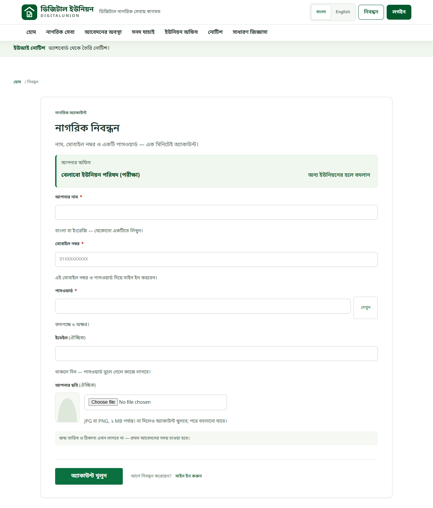
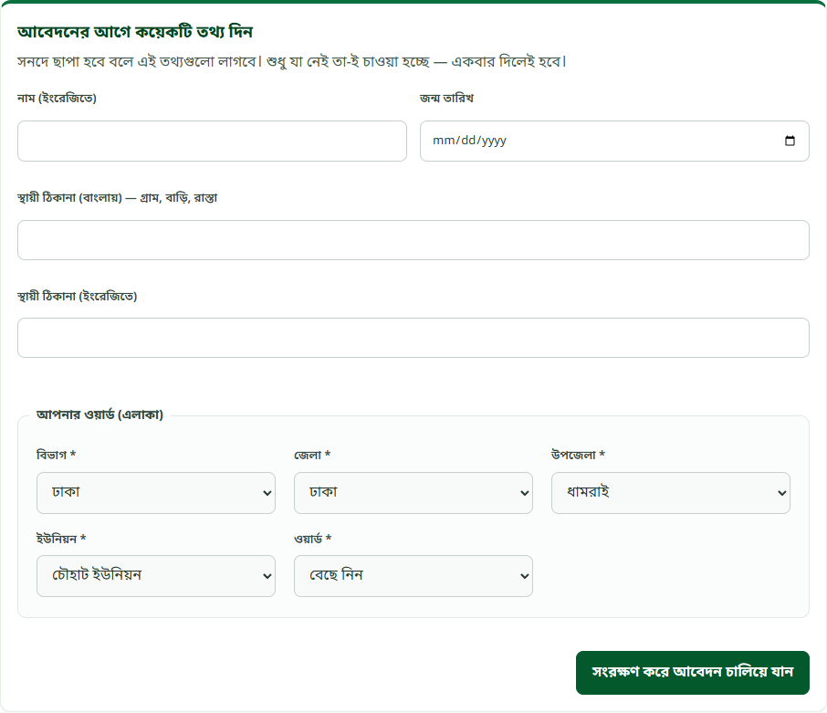
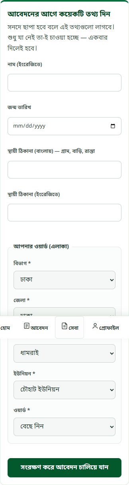

# Phase 1 — REG-UX foundation (guide §6, §15 step 1)

**Date:** 22 Nov 2026 · **Merged:** PR #57 into `codex/initial-deployment` (merge commit `e6ea2d6`), CI green on head `8f23741` (verify, real-antivirus, docker-build, GitGuardian — all SUCCESS).
**Follow-up in this PR (#58):** a label-layout fix (required `*` and "(ঐচ্ছিক)" stay on the label line) plus this report. CI runs on it before merge.
**Production:** untouched. The deploy stays the owner's cPanel step. The r7 zip was not touched.

## What changed

| Area | Change |
|---|---|
| DB — migration 056 | `citizens.date_of_birth`, `address_bn/en`, `full_name_bn/en` may be NULL until the citizen provides them (CHECK: at least one name). No placeholder values, ever. `account_identifiers.self_declared` marks a mobile bound without an OTP. No data rewritten. |
| Signup API | `POST /auth/signup` also accepts the short shape `{ tenantId, name, mobile, password, email?, photo? }`. The full payload is unchanged. A Bangla-script name lands in `full_name_bn`, a Latin one in `full_name_en`. The area derives from the office (ward deferred). The optional photo becomes the profile photo. |
| K2 (owner-confirmed for the pilot) | Email is optional. The mobile is the sign-in identifier without OTP, stored `self_declared = true`. An email-less account holds an internal `@no-email.digitalunion.invalid` address that is never shown or mailed (`sendEmail` refuses it). To revisit when the SMS worker goes live. |
| Errors | `EMAIL_TAKEN` and `IDENTIFIER_TAKEN` carry `error.field` and a Bangla-first message with the remedy (sign in). Zod issues keep their paths. The web maps both to the field (`fieldErrors()`), focuses the first one, and offers a "সাইন ইন করুন" button at a taken email/mobile. |
| Apply gate | `POST /applications` returns `409 PROFILE_INCOMPLETE` with `missing[]` **only** for the deferred items (name in both scripts, DOB, address, ward at a mapped office). NID and mobile are not demanded. The issuance gate (`require_complete_profile`) is unchanged. |
| Profile completion | `PATCH /citizens/:id/profile` is fill-only: it sets empty values and refuses to rewrite existing ones (`PROFILE_VALUE_PRESENT`). |
| Web — signup | One screen. 3 required fields (name, mobile, password) + optional email + optional photo. The office is preselected as a **default** (K3): `?office=<slug>`, else the server's `DEFAULT_SIGNUP_OFFICE_SLUG`, else the only listed office. A "অন্য ইউনিয়নের হলে বদলান / Change" link opens the area→office picker. The success screen hands over to a sign-in form prefilled with the mobile (or email). |
| Web — apply | Before the form, an inline card asks for only the missing items, saves them, and continues into the form. |
| Config | New optional env `DEFAULT_SIGNUP_OFFICE_SLUG` (documented in `.env.example`, `.env.cpanel.example`). Pilot value: `belabo-up` (owner sets it in the cPanel env UI). |

Timed walkthrough (automated browser, `execution/reg-ux-walkthrough.json`): **1 screen, 3 required typed fields, account created in 1.4 s** of scripted time. That proves the flow length only; a human-timed walkthrough is NOT VERIFIED.

## Test tallies (local, fresh DB per run, actual log counts)

| Suite | Baseline — origin `75e40fa` | Branch — `8f23741` (final full run) |
|---|---|---|
| Forms | 83 / 83 | 83 / 83 |
| API | 306 / 313 | **315 / 322** (+9 new: `signup-short.test.ts`) |
| Web | 109 / 109 | **109 / 109** |
| `tsc --noEmit` | clean | clean |

- **API, 7 failures on both sides:** all are react-pdf/PDF tests that shell out to `pdftotext -bbox`. This machine has xpdf 4.06, which has no `-bbox`; CI installs poppler. CI `verify` (full suites with poppler) is green on the branch head.
- **Web, price-list browser test:** in an earlier branch run it failed with `service 45 shows statutory + processing = ৳15.75 (0 !== 1)`. Reproduces identically on clean origin HEAD 75e40fa — not caused by these changes. Cause not yet identified (passed in the earlier baseline run); labelled UNVERIFIED, under observation. It passed in the final full branch run above.
- **Web, family/trade browser test:** failed in one full branch run. Cause found and **fixed**. The new API tests had created short-signup citizens (deferred profile) in the shared `alpha` demo office. The browser test picks the first citizen in that office, got one of them, and correctly saw the completion card instead of the form. The API tests now run in their own office (commit `8f23741`). It passed in the final full run.
- **Web, staff citizen registration test:** fails with `409 DUPLICATE` when re-run on a non-fresh DB, because it re-creates fixed data. This is a known test-isolation weakness (fixed data reused on a non-fresh DB), not a product defect. It passes on a fresh DB, including the final run. It does not block Phase 1. See follow-ups.

## Screenshots (Bangla UI, local stack)

| | Desktop (1280) | Mobile (390) |
|---|---|---|
| One-screen signup |  |  |
| Inline completion card |  |  |

The mobile apply-flow and signup screenshots from the browser suite are also in `execution/screenshots/reg-ux-*.png`.

## NOT VERIFIED

- The 7 `pdftotext -bbox` API tests locally (CI green covers them).
- The price-list test's earlier failure: cause unknown (UNVERIFIED, under observation).
- A human-timed walkthrough on a real phone (< 60 s target); only the automated one ran.
- Post-signup mobile **OTP verification UI**. The OTP prompt is intentionally absent while no SMS delivery is live, and the SMS worker (migration 057) is not in this repo. Self-declared mobiles stay self-declared.
- `DEFAULT_SIGNUP_OFFICE_SLUG` on production (owner's cPanel env step). Without it, production preselects only if exactly one office is listed.
- Production / cPanel single-role migration of 056. The migration is additive (`ALTER … DROP NOT NULL`, `ADD COLUMN … DEFAULT false`) and ran on the two-role local and CI tracks only.
- The label-layout fix in PR #58 ran through `tsc` and the screenshot script only; the full local suites ran on `8f23741`, before it. CI on #58 is its gate.

## Follow-ups

1. Make the staff citizen-registration browser test idempotent (unique data per run), so it passes on a non-fresh DB.
2. Investigate the intermittent price-list browser failure.
3. Post-signup OTP verification (clears `self_declared`) once the SMS worker lands.
4. Ward step in the completion card: the full area cascade is shown prefilled; a ward-only select would be lighter (PP-2 inline-gate work).
