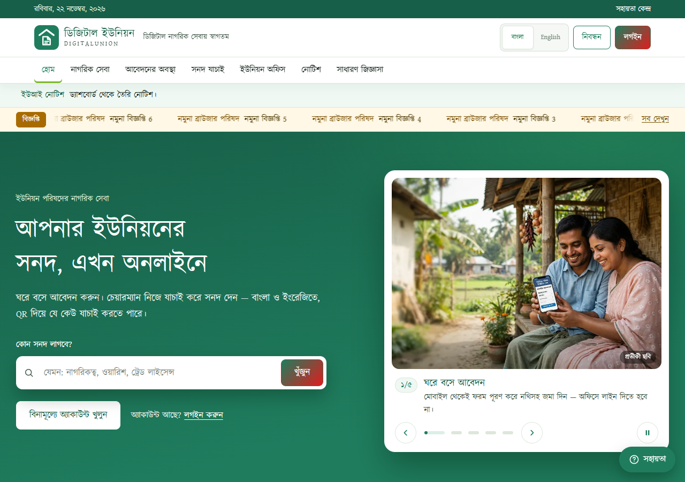
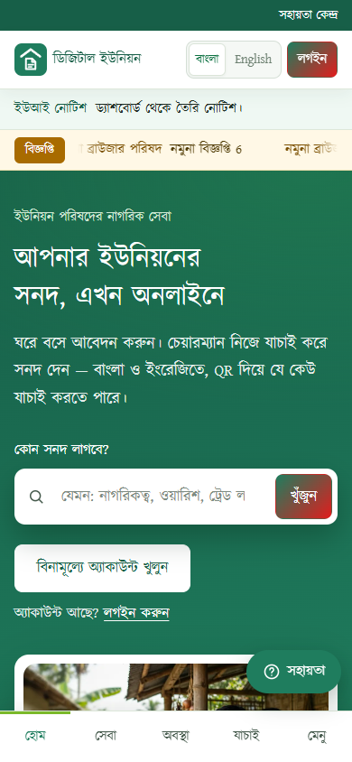
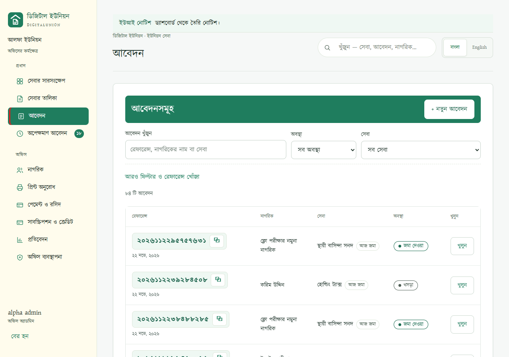
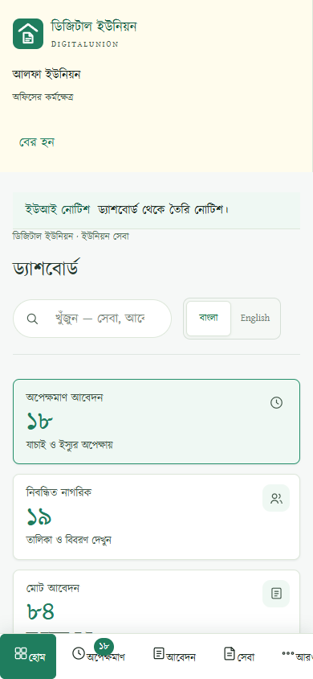
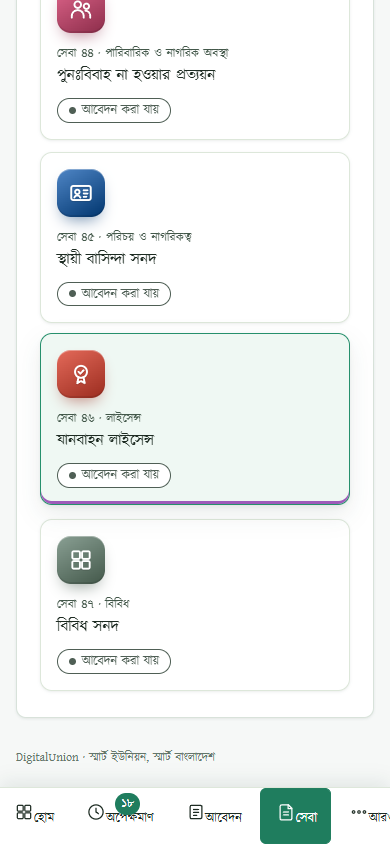

# Phase 2 — PP-1 Theme (guide §4, §15 step 2; parity note §1A)

**Date:** 22 Nov 2026 · **Branch:** `feat/pp1-theme` (2 commits on `3a46e9e`) · PR into `codex/initial-deployment`, merged only on green CI.
**Scope:** presentation only — CSS and design tokens, plus one status→colour mapping in `ui/kit.tsx`. **No API, schema, package or migration change** (`git diff 18fe43c feat/pp1-theme -- apps/api packages` is empty). Production untouched.

## What changed (parity rows)

| Row | Change |
|---|---|
| L1 chrome green | Tokens retokened to the `#1f7d5e` family (`--du-green-700 #1f7d5e`, `-800 #175f48`, …). White text: 5.0:1 on `#1f7d5e`, 7.4:1 on `#175f48`. Hard-coded copies of the old greens in 7 stylesheets follow. The logo lockup and the sample-certificate visual keep their own colours (certificate look is locked, guide §11). |
| L2 primary button | Every primary action uses the 135° `#1f7d5e → #e01d1d` gradient with white text (white on `#e01d1d` = 4.6:1). The hover state is the darker ramp. Secondary and text buttons are unchanged. |
| L3 sidebar | Cream `#fffced`. The active row is solid green with white text and icon and a 3 px red left edge. Ink on cream is 14:1. |
| L4 font | Kalpurush is first in the Bangla stack. The workspace root now uses the `--ax-font` token like the public shell. Self-hosted Noto Sans Bengali remains the guaranteed fallback. |
| L5 Bangla numerals | Already in place (`ui/fmt.ts`); no change. |
| L6 section bars | Workspace panel headings and apply-flow step titles are green bars with white titles. Controls inside switch to their on-dark form: white links and text buttons; primary becomes white with green text. |
| L7 page | Light grey ground (`#eef2f0`); white cards unchanged. |
| L8 status pills | Outline pills: a 1.5 px border in the status colour on white. Submitted and resubmitted are green; approved and issued are **purple**; rejected, revoked and correction-needed are red. The other states keep their tones. Astra's 11-state vocabulary is unchanged. |
| L9 purple accent | Service tiles get a purple (`#9e5bba`) underline on hover and keyboard focus. |

## Test tallies (local, fresh DB `astra_pp1`, actual log counts)

| Suite | Baseline — origin `75e40fa` | Phase 1 merged (`8f23741`) | Phase 2 branch |
|---|---|---|---|
| Forms | 83 / 83 | 83 / 83 | **83 / 83** |
| API | 306 / 313 | 315 / 322 | **314 / 322** |
| Web | 109 / 109 | 109 / 109 | **108 / 109** |
| `tsc --noEmit` | clean | clean | clean |

- **API, 7 of the 8 failures:** the known local-only `pdftotext -bbox` / `pdfinfo` gap (xpdf on this machine, poppler on CI). Identical on baseline.
- **API, the 8th — `Audit 01 F8: LIKE metacharacters…` (hardening.test.ts): a pre-existing flaky test, cause identified, not caused by this phase.** Phase 2 changes no API code (empty diff above). The citizen search also matches the *digits* of the query against reference numbers, with no minimum length (`referenceDigits`, `apps/api/src/references.ts:24`). The test's run id is 8 random hex characters; when it holds only one or two digits, `%<digits>%` matches nearly any 16-digit reference, including the "X" citizen's. Re-ran the test 3× on the same DB: 3/3 pass. The underlying search behaviour is a real product issue (a name search containing a digit or two matches unrelated references); see follow-ups.
- **Web, the 1 failure — price-list browser test: cause identified and fixed in this PR (test-only).** It reproduced identically on clean origin HEAD 75e40fa, so it was never caused by these changes. It also failed once on CI for this PR (the `pull_request` run; the `push` run of the same commit passed). Cause: the test searched for its new office, then immediately clicked the *first* "View office" button. When the search results had not yet replaced the default office list, that opened a different office, whose price list has no published fee. The test now clicks the button inside the card carrying its own office name. Verified 3/3 consecutive local runs. The application code is unchanged.

## Screenshots (Bangla UI, local stack)

| | Desktop (1280) | Mobile (390) |
|---|---|---|
| Public home (gradient header buttons and search) |  |  |
| Workspace — cream sidebar, solid active row, green bar, outline pills |  |  |
| Service list — outline pills, purple hover underline | — |  |

Phase 1's signup and completion-card screenshots (`phase1/`) were taken before this theme.

## NOT VERIFIED

- **Kalpurush on real citizen devices.** No Kalpurush font file is bundled; it renders only where the device already has it (this PC does, so the screenshots show it). Everyone else sees self-hosted Noto Sans Bengali. Bundling it needs the owner's OK for an external font file plus a licence check.
- The exact Prottoyon hex values: the live site exposes no hex, so the values come from the parity note's zip audit (`#1f7d5e`, `#e01d1d`, `#fffced`, `#8e53a1`, `#9e5bba`).
- Contrast ratios are calculated from the token values, not measured with a tool on every surface.
- A support banner or floating button driven by real contact values (parity A6): the owner has not supplied the phone and email, so nothing was added.
- Owner-console and print/PDF views were not screenshot-reviewed for this theme. PDFs are untouched by design.
- The 7 local PDF tests (CI covers them).

## Follow-ups

1. Bundle Kalpurush once the owner approves the file and licence.
2. Citizen search: require a minimum digit count (e.g. ≥ 4) before matching reference digits; then the `F8` test stops flaking.
3. Carried from Phase 1: make the staff citizen-registration browser test idempotent.
